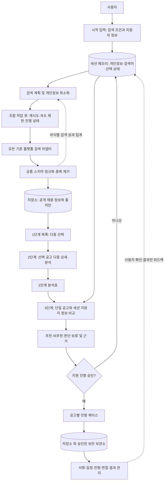

# 채용 검색·분석·지원 목표 구조 설계

상태: 목표 구조 및 구현 기준
범위: 검색 계획부터 공고별 지원 진행 관리까지의 목표 구조
개인정보 경계: 지원자 개인정보, 그 파생 평가, 지원서류 및 개인별 전형 이력은 이 저장소에 저장하지 않는다.

## 결정 요약

기능 흐름을 다음 세 단계와 지원 워크플로로 나눈다.

1. 검색 결과를 공통 형식으로 수집·정리하고 사용자가 여러 공고를 선택한다.
2. 선택한 여러 공고의 공식 공고 내용과 조건을 분석·평가한다.
3. 사용자가 선택한 한 공고에 대해 지원자 적합성을 평가하고 추천·비추천·판단 보류를 제시한다.
4. 사용자가 지원을 승인한 공고마다 독립된 전형 케이스를 열어 서류·일정·전형·면접·결과를 관리한다.

지원자 정보는 최초 검색 요청 시 직접 요청한다. 해당 정보는 실행 세션 메모리에서만 사용한다. 검색어, 지원자 자료, 개인별 평가, 생성 서류, 선택 기록, 일정과 전형 결과를 저장소 파일·로그·캐시·테스트 픽스처에 기록하지 않는다. 장기 전형 관리에 필요한 개인별 상태는 저장소 바깥의 승인된 보안 저장소가 있을 때만 보존한다.

## 구현 현황과 남은 범위

코드에서 확인된 기존 동작 (변경 전):

- `run_pipeline.py`는 계획 검색어를 `query_axes`, `queries_executed`로 실행 로그에 저장한다. 이 값은 사용자가 제공한 검색 조건에서 유래할 수 있다.
- 수집 후 누적 공고 원장 전체를 `run_analysis_pipeline`에 전달한다. 사용자가 고른 공고만 상세 분석하는 선택 단계는 없다.
- `--job-match-input`은 파일에서 지원자 자료를 읽고 평가 결과를 `data/job_match_evaluations.jsonl`에 저장한다.
- `job_matching_model.py`는 지원자 자료를 정규화 프로필로 저장하지 않는다고 명시하지만, 실행 계층은 평가 결과와 근거 발췌를 파일에 남긴다.
- 검색 원장과 분석 파이프라인은 있으나, 공고별 지원 케이스·일정·전형 상태 관리는 없다.

현재 구현은 검색 실행 로그에서 원문 검색어와 축을 제외하고, 검색 및 분석 실패 메시지를 안전한 상태 코드로 제한한다. 1단계는 수집에만 집중하고, 2단계는 명시적으로 선택한 공고만 처리한다. 대화형 세션은 시작 시 검색 조건·지원자 정보를 받아 개인별 입력과 평가를 메모리에서만 처리하며, 3단계는 한 공고만 평가한다. 추천 점수 기준은 사용자 설정이며 보정된 예측 모델이 아니다.

장기 지원 케이스의 저장소 밖 보안 저장소, 실공고 상세 검증 서비스, 운영 API별 외부 데이터 처리 조건은 아직 연결·확인되지 않았다. 이 문서는 목표 구조와 구현 기준이며, 운영 검증을 뜻하지 않는다.

## 목표 요청 흐름

검색 성과·오류 지표는 저장소에 쓸 수 있지만, 검색어 원문이나 사용자와 연결되는 식별자는 포함하지 않는다. 그림의 지원자 자료와 개인별 상태 저장소는 세션 메모리 또는 승인된 외부 보안 보관소를 뜻하며 저장소 파일이 아니다.

## 개인정보 및 데이터 보관 경계

| 데이터 | 저장소 보관 | 처리 위치 및 규칙 |
|---|---|---|
| 공개 채용 공고·공식 URL·출처·공고 변경 이벤트 | 허용 | 기존 공고 원장에 저장. 지원자 ID·선택 기록과 연결하지 않음 |
| 검색어 원문·사용자 검색 조건 | 금지 | 세션 메모리에서 생성·실행. 영속 로그에는 무작위 실행 ID와 집계 수치만 기록 |
| 이름·연락처·주소·이력서·자기소개서·지원자 이력 | 금지 | 시작 시 직접 요청하되 세션 메모리에서만 보유. 검색어에는 직접 식별자를 포함하지 않음 |
| 개인별 적합도 점수·근거 발췌·추천 결과 | 금지 | 사용자에게 세션 응답으로만 제공. `job_match_evaluations.jsonl`로 저장하지 않음 |
| 사용자의 선택·제외 이유 | 금지 | 세션 중 검색 개선에만 사용. 저장소에는 개인별 선택을 남기지 않음 |
| 지원서 초안·면접 메모·지원 일정·전형 결과 | 금지 | 장기 보관이 필요하면 저장소 밖의 승인된 보안 보관소에 저장 |
| API 키·개인별 입력이 든 예외 메시지 | 금지 | 비밀 값과 요청 본문을 로그에서 제외하고 오류 유형·제공자·상태만 기록 |
| 검색 수·중복 수·플랫폼별 성공·지연시간 | 허용(비식별 집계) | 검색어·개인 세션과 연결할 수 없는 형태로 기록 |

암호화하거나 해시한 이력서·검색어도 이 저장소에 두지 않는다. 해시는 개인정보 파생값이나 사전 대입 식별 단서가 될 수 있으며, 저장 금지 요구를 우회하는 수단으로 취급하지 않는다.

### 세션 생명주기

- 시작 입력을 받은 뒤 임시 세션을 만들고, 검색어·지원자 자료·선택 목록·평가 결과를 메모리에 보유한다.
- 세션이 끝나거나 시간 제한이 지나면 임시 데이터를 폐기한다. 프로세스가 중단된 뒤에는 개인정보가 든 검색어를 저장소에서 복원하지 않는다.
- 재개가 필요한 경우 사용자가 시작 정보를 다시 제공한다. 저장소 안의 영속 체크포인트는 개인정보 없는 상태와 집계만 보존한다.
- 지원 케이스의 장기 이력이 제품 요구사항이라면, 별도 승인된 보안 보관소와 인증·접근 통제·보존 기간·삭제 절차를 먼저 확정한다. 그 전에는 세션 밖으로 개인별 상태를 내보내지 않는다.

## 단계별 책임과 계약

### 시작 입력

한 번에 요청하되 항목을 목적별로 나눈다.

- 검색 조건: 희망 직무·분야, 기관 유형, 지역, 고용 형태, 근무 조건, 제외 조건.
- 지원자 자료: 직무 경험, 기술·역량, 학력·자격 등 평가에 필요한 최소 정보와 필요 시 원문 자료.
- 처리 안내: 검색어에 직접 식별자를 보내지 않는다는 점, 제공자 호출 경계, 세션 종료 시 폐기 범위.

검색 API가 어떤 입력을 외부 처리하는지와 지원자 원문을 외부 분석 서비스에 전달할지 여부는 제공자별 계약·보존 정책 확인 전까지 미확정이다. 직접 식별 정보는 어떤 검색 API 호출에도 보내지 않는다. 외부 모델 분석에 원문을 보낼 경우에는 허용된 제공자와 전송 범위를 먼저 정해야 한다.

### 1단계: 검색·목록 정리

- 모든 기준 플랫폼과 계획 검색 조합을 실행 대상으로 유지한다. 묶음 호출은 플랫폼별 결과를 각 플랫폼으로 분배하고 모든 조합의 상태를 기록해야 한다.
- 검색 계획, 반복 조회, 재시도는 세션 메모리에 두고, 영속 로그에는 검색 원문 대신 무작위 조합 ID, 플랫폼, 상태, 결과 건수, 시간만 남긴다.
- 공급자 응답을 내부 공통 채용 정보 스키마로 정규화한다. 미제공 값은 `unknown`으로 두고 임의로 추정하지 않는다.
- URL/공고 ID 기준 중복을 정리하되 대체 출처와 출처별 관측은 보존한다.
- 후보 목록은 공고 관련성 및 정보 완전성으로 정렬할 수 있으나 지원자 적합도나 추천 판단을 표시하지 않는다.
- 정규화된 공개 공고 목록은 사용자 선택 이후에도 재사용할 수 있다. 사용자의 선택 자체는 저장소에 기록하지 않는다.

### 2단계: 선택 공고 상세 분석

- 사용자가 고른 여러 공고 ID만 분석 큐에 넣는다.
- 공식 공고, 마감, 자격, 업무, 근무 조건, 보상 근거와 정보 충돌을 확인한다.
- 범주별 표에는 상태·근거 링크·미확인 사항을 함께 표시한다. 근거 없는 항목은 비어 있음 또는 판단 보류로 표시한다.
- 공고 자체에 관한 검증 결과는 공개 채용 정보이므로 저장소에 재사용 가능하다. 선택 이유나 지원자 자료와 결합한 해석은 저장하지 않는다.
- 새로 선택된 공고와 공고 내용이 바뀐 항목만 실행한다. 이미 분석한 동일 버전의 공개 공고는 분석 결과를 재사용한다.

### 3단계: 단일 공고 적합성 평가

- 한 번에 한 공고만 선택한다. 해당 공고 요건과 시작 시 받은 지원자 자료를 세션 메모리 안에서 비교한다.
- 출력은 요건별 상태, 점수(근거가 있을 때), 근거·반대 근거, 불확실성, 전체 근거 범위, 추천 의견을 포함한다.
- 추천은 `추천`, `비추천`, `판단 보류`를 사용한다. 필수 요건을 확인하지 못한 상태를 자동 비추천으로 취급하지 않는다.
- 초기 추천 규칙은 사용자 설정 전체 적합도 하한, 필수 자격 PASS, 각 필수 요건 점수 3/5 이상을 요구한다. 이 점수 규칙은 사용자가 확인할 수 있도록 공개하며 경험적으로 보정된 예측 모델로 표현하지 않는다.
- 평가 결과와 지원자 근거 발췌는 저장하지 않는다. 필요하면 사용자가 저장소 밖의 승인된 위치로 직접 저장한다.
- 보호 특성은 검색·적합성 기준에 사용하지 않는다. 점수는 결정 자동화가 아닌 검토 지원으로 표시한다.

### 승인된 공고별 지원 관리

- 지원 진행은 추천 결과와 별개의 명시적 사용자 승인으로 시작한다.
- 공고마다 별도의 케이스 상태와 이벤트 이력을 둔다: 자료 확인 → 서류 초안 → 사용자 검토·승인 → 사용자가 확인한 지원 상태 → 서류 결과 → 면접 준비·일정 → 최종 결과.
- 초안 생성과 실제 제출 상태를 구분한다. 사용자가 승인하거나 외부 결과를 확인하기 전에는 제출·합격·불합격을 단정하지 않는다.
- 일정·서류·결과는 개인정보이므로 장기 케이스 저장소는 저장소 밖에 둔다. 연결 대상이 승인되지 않았다면 세션 안에서만 관리하고 세션 종료 시 폐기한다.

## 검색 비용·처리량 설계

- 검색어 조합을 provider adapter 요청 큐에 넣고 동시성·속도 제한·시간 예산을 제공자별로 적용한다. 동시성은 제공자 한도 확인 후 설정한다.
- 현재 코드의 묶음 검색은 호출 수를 줄이는 기반이지만, 여러 도메인을 한 요청으로 묶을 때 결과가 특정 플랫폼에 몰릴 수 있다. 플랫폼별 반환 비율과 고유 공고 수를 측정하고, 부족한 플랫폼에만 보충 검색을 한다.
- 검색어별 성과는 세션에서 계산한다. 누적 검색량보다 신규 고유 공고, 공식 출처 확인 가능성, 사용자가 관심 표시한 결과를 지표로 삼는다.
- 낮은 한계 수익의 검색 조합은 예산 안에서 후순위로 둔다. 단, 사용자가 지정한 기준 플랫폼은 실행 또는 명시적 실패로 항상 보고한다.
- HTTP 캐시나 검색 쿼리 해시를 저장소에 두지 않는다. 캐시 키가 사용자 조건을 추론하게 될 수 있다. 세션 내 메모리 캐시와 공개 공고 ID 기반 재사용을 우선한다.
- 조합별 체크포인트는 민감한 쿼리 원문 없이 상태만 저장한다. 정확히 이어서 재개해야 할 때는 사용자가 입력을 다시 제공해 계획을 재생성한다.
- 전체 레저를 매번 재분석하지 않고 신규·변경된 공고 및 선택된 항목에만 분석 서비스를 호출한다.

## 조정 계층과 상태

요청 조정기는 다음 정보를 구분해 관리한다.

- 영속 검색 실행: 무작위 실행 ID, 단계 상태, 플랫폼별 완료·실패 수, 집계 시간·결과 수, 비개인 오류 코드.
- 공개 공고 상태: 공고 ID, 정규화 정보, 원본 URL, 수집·검증 이벤트, 내용 버전.
- 세션 상태(메모리 전용): 지원자 입력, 검색어 원문, 선택 ID, 평가 결과, 현재 단계.
- 개인별 지원 케이스(승인된 외부 저장소 전용): 지원 문서·일정·전형 이벤트와 사용자별 연결 정보.

단계 상태는 `PENDING`, `RUNNING`, `COMPLETED`, `PARTIAL`, `FAILED`, `CANCELLED`로 구분한다. 각 작업은 재실행 가능한 입력 버전과 공고 내용 버전으로 식별한다. 재시도는 일시적 오류에 한정해 횟수·지연을 제한하고, 사용자 승인 또는 외부 제출은 재시도 큐에서 분리한다.

## 실패 동작과 복구

| 상황 | 동작 |
|---|---|
| 제공자 오류·속도 제한 | 제공자별 제한 시간과 제한된 재시도 적용. 반복 실패 시 해당 플랫폼을 실패로 기록하고 나머지 플랫폼은 계속 진행 |
| 한 플랫폼만 결과 없음 | 오류와 정상 0건을 구분해 기록. 전체 검색 성공 여부를 결과 건수만으로 판단하지 않음 |
| 묶음 검색의 플랫폼 편중 | 반환 건수 분포를 확인하고 결과가 부족한 플랫폼 조합에 한해 보충 검색 |
| 분석 작업 중 중단 | 공개 공고 버전 기준 완료된 결과 재사용. 지원자 평가는 세션 자료가 없으면 재실행하지 않고 사용자에게 자료를 다시 요청 |
| 사용자 취소·세션 만료 | 진행 중 작업 취소, 메모리의 지원자 자료·검색어·선택 정보를 폐기 |
| 외부 제출 결과를 확인할 수 없음 | `UNKNOWN`으로 남기고 자동 재제출하지 않음. 사용자가 외부 상태를 확인한 뒤 갱신 |

## 구현 순서

1. **완료:** 원문 질의 로그 제거, 일부 식별자 패턴의 검색 전 제거, 지원자 정보·평가 파일 경로 제거, 세션 전용 개인별 입력.
2. **완료:** 1단계 검색과 2단계 선택 공고 분석 분리, 3단계 단일 공고 평가 및 다중 근거·요건 입력.
3. **부분 구현:** 지원 준비 승인은 명시적으로 확인하고 세션 내 단계 변경을 허용한다. 프로세스 종료 뒤에도 이어지는 지원 케이스 저장은 외부 보안 저장소가 정해지지 않아 제외했다.
4. **후속:** 제공자별 비용·플랫폼 분포 측정, 편중 보정용 보충 검색, 재시도 예산과 영속 체크포인트.
5. **후속:** 운영에 사용할 공식 공고 분석 서비스와 외부 모델 데이터 처리 조건 확인.

## 완료 조건과 확인 필요 사항

- 검색어 원문, 지원자 자료, 개인별 평가, 지원서류, 일정, 사용자 선택이 저장소 전체에 저장되지 않는다.
- 1단계 실행에서 모든 기준 플랫폼이 완료·실패·차단 중 하나로 명시된다.
- 2단계 분석은 사용자가 선택한 공고만 실행하고, 공식 출처 근거와 미확인 사항을 표시한다.
- 3단계는 단일 공고를 평가하며, 개인별 평가 데이터는 세션 종료 뒤 저장소에서 찾을 수 없다.
- 신규·변경 공고만 재분석하고, 중복 실행과 외부 부작용을 분리한다.
- 외부 제공자에 지원자 자료나 파생 정보가 전달되는 범위와 보존 정책이 확인되기 전에는 원문 전송을 활성화하지 않는다.
- 장기 지원 케이스에 쓸 외부 보안 저장소, 접근 통제, 삭제·보존 기간은 아직 제품 결정을 필요로 한다.

## 관련 아키텍처 참고

[Explore Architecture templates in Codelit](https://codelit.io/templates)
